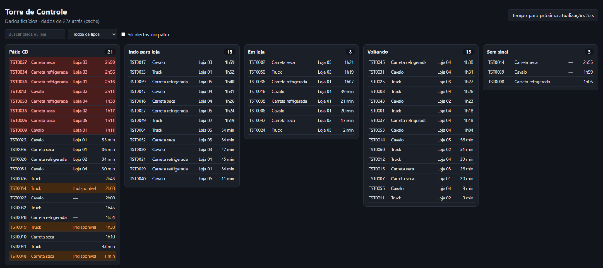
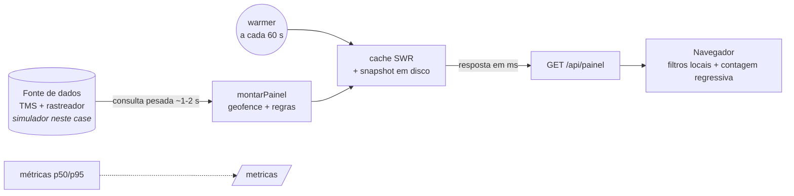

# torre-de-controle-frota

Painel de **torre de controle** para uma operação de distribuição: mostra em tempo real onde está cada veículo — **pátio do CD, indo para a loja, em loja, voltando ou sem sinal** — e destaca o que precisa de ação. Backend em **Node.js/Express** com **cache "frio" aquecido em segundo plano**, filtros 100% no navegador e uma página interna de **métricas de tempo**.

> Case de portfólio escrito do zero, com frota, lojas e coordenadas **fictícias** (a fonte de dados é um simulador). Reproduz o desenho e as soluções de um painel que mantenho em produção — sem nenhum código, consulta ou dado de empresa.




## Problemas reais que este desenho resolve

| Problema | Solução |
|---|---|
| Cada recarga levava **1 a 2 minutos** esperando as consultas | **Cache stale-while-revalidate**: a requisição recebe na hora o último payload pronto; um *warmer* reconsulta o banco em segundo plano; chamadas simultâneas viram uma só consulta |
| A primeira carga depois de reiniciar o servidor era lenta | **Snapshot em disco**: o servidor sobe servindo o último payload conhecido |
| Cada filtro refazia a consulta inteira | O navegador recebe tudo uma vez e **filtra localmente** — instantâneo |
| Veículo aparecia em dois quadros ao mesmo tempo (ex.: "pátio" e "indo para loja") | **Geofence** (raio do CD e das lojas, fórmula de Haversine) + regras com **ordem de prioridade**: cada veículo cai em um único quadro |
| Programado parado no pátio passava despercebido | Destaque em **vermelho** para programado há mais de 1 h no pátio, **laranja** para indisponível; programados no topo, do mais antigo para o mais novo |
| "Qual consulta está deixando o painel lento?" | Página interna **/metricas** (sem link na interface) com p50/p95/máx por consulta, montagem de cache e rota HTTP |



Na página de métricas do projeto rodando: a consulta à fonte leva ~1.300 ms, e `GET /api/painel` responde em 1-6 ms porque sai do cache.

## Rodando

Precisa de Node 20+.

```bash
npm install
npm start          # http://localhost:3000   ·   métricas em http://localhost:3000/metricas
npm test           # 16 testes (node:test): geofence, regras, cache SWR, snapshot, API
```

Variáveis opcionais: `PORT`, `PAINEL_TTL_MS` (idade máxima do cache, padrão 60 s), `PAINEL_AQUECER_MS` (intervalo do warmer, padrão 60 s), `SNAPSHOT_DIR`.

## Estrutura

```
src/
├── dominio/
│   ├── geo.js            # distância (Haversine) e geofence
│   └── classificacao.js  # quadro de cada veículo, alertas, ordenação, contadores
├── cache/swrCache.js     # stale-while-revalidate + warmer + snapshot + dedupe
├── metricas/metricas.js  # p50/p95 em memória por consulta, cache e rota
├── fonte/simulador.js    # frota fictícia e latência de banco simulada
├── app.js                # rotas Express
└── server.js
public/                   # front sem framework (HTML + JS + CSS, tema claro/escuro)
test/                     # node:test
```

Em produção, `fonte/simulador.js` é substituído pelas consultas SQL ao TMS e ao rastreador; o resto do código não muda.
